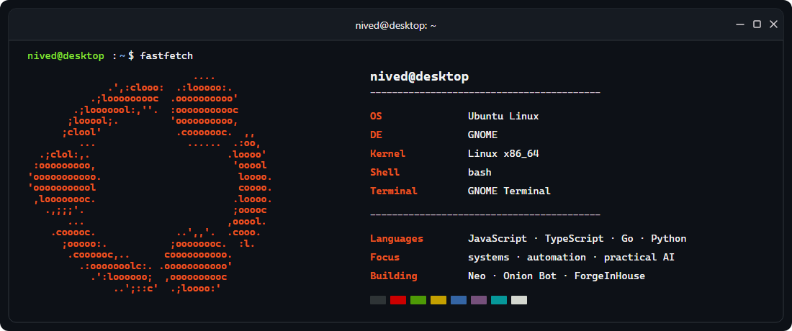

# Hi, I'm Nived 👋

I build useful automation for real problems, focusing on system design, scalable backends, and
practical AI. I enjoy entrepreneurship and turning rough ideas into products people can use.

## Start Here

- 🧠 **[Neo](https://github.com/0xNived/Neo)** — Local-first AI assistant for memory and safe automation.
- 🛡️ **[Onion Bot](https://github.com/0xNived/Onion-Bot)** — Discord moderation and server protection.
- 🌍 **ForgeInHouse** *(private)* — 2D tile-world sandbox with a day/night cycle.

## Connect

---

Currently building Neo, one useful capability at a time.
